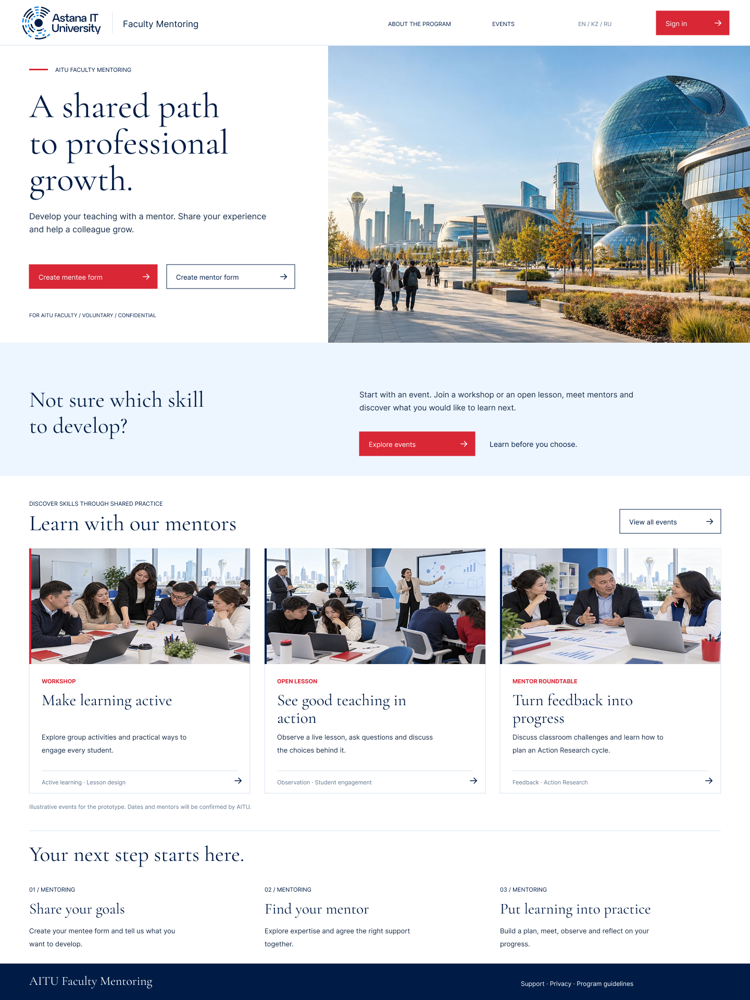
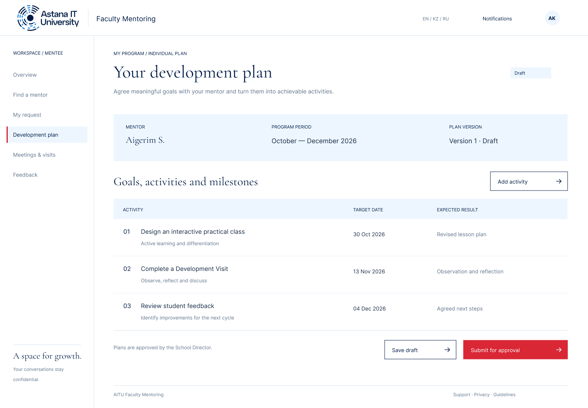
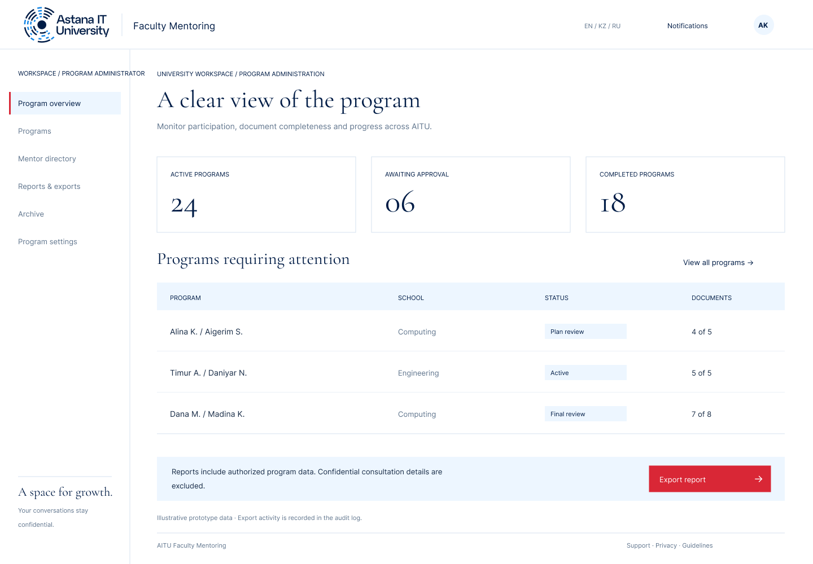

<div align="center">

# AITU Faculty Mentoring

**Платформа профессионального развития преподавателей**

[Прототип в Figma](https://www.figma.com/design/sy5nfmGGIJu1W4KQk1Tm6d/?node-id=8-2) · [YouTrack](https://karinatulegenova.youtrack.cloud/issues/DIP) · [Документация](#документация) · [Запуск](#запуск-и-тесты)

</div>


Дипломный проект по разработке веб-платформы для управления системой наставничества преподавателей в высшем учебном заведении. Платформа связывает профессиональный запрос, выбор наставника, согласование пары, индивидуальный план, встречи и оценку результатов.

Подготовка к **24 октября 2026**: [критерии и состояние](docs/project/readiness.md), [сверка ТЗ](docs/tz-traceability.md), [задачи YouTrack](docs/project/youtrack.md).

Автор: Тулегенова Карина Маратовна, Software Engineering, группа SE-2419. Руководитель: Тулебаев Ерсултан Бахытович. Автор отвечает за анализ, архитектуру, frontend, backend и проверку системы.

## Проблема и пользователи

Положение AITU предусматривает несколько связанных документов и этапов организации наставничества. Проект объединяет их в одном процессе и делает статус взаимодействия доступным участникам. На встрече с клиентами 8 октября 2026 обсуждены роли и конфиденциальность, запросы и назначения, индивидуальные планы и обратная связь, мониторинг и отчетность. [Тезисы встречи и связь с требованиями](docs/research/user-research.md).

Пользователи: преподаватели-наставники и наставляемые, представители Школы, директор Школы, академический департамент, регистратор распоряжений и организаторы мероприятий. Наставничество предназначено для профессионального развития; подробные наблюдения и рефлексия пары остаются конфиденциальными.

## Возможности

- Две формы подачи: карточка кандидата в наставники и запрос наставляемого.
- Каталог навыков и витрина мероприятий с поиском и выбором направления.
- Проверка кандидата Школой и подтверждение вводного инструктажа.
- Выбор наставника, согласие обеих сторон, представление директора и регистрация распоряжения проректора.
- Совместный индивидуальный план с версиями, задачами, сроками, поддержкой и ожидаемыми результатами.
- Встречи, Development Visit, промежуточная и итоговая оценка.
- Обращения о замене и обобщенные показатели программы.

## Прототип приложения

Экранные макеты экспортированы из **AITU Faculty Mentoring — Prototype**, страница **Refined · AITU Editorial**, 15 октября 2026. Они показывают целевой интерфейс. Локальный HTML/JS-прототип проверяет отдельные сценарии процесса; его реализация пока отличается от макетов Figma.

| Главная | Каталог наставников |
| --- | --- |
| [](docs/assets/prototype/01-landing.png) | [](docs/assets/prototype/04-mentors.png) |
| Знакомство с программой, навыками и возможностями поддержки | Поиск наставника и просмотр профессионального профиля |

| Индивидуальный план | Development Visit |
| --- | --- |
| [](docs/assets/prototype/06-plan.png) | [](docs/assets/prototype/07-visit.png) |
| Цели развития, мероприятия, сроки и прогресс | Подготовка визита, наблюдения и обратная связь |

<details>
<summary><strong>Обзор программы для УМО</strong></summary>



Мониторинг активности и комплектности документов. Доступ к частным наблюдениям пары ограничивается требованиями конфиденциальности.

</details>

[Открыть все экраны Figma](https://www.figma.com/design/sy5nfmGGIJu1W4KQk1Tm6d/?node-id=4-2) · [Сценарий локальной демонстрации](docs/prototype.md)

## Основания и обратная связь

| Источник | Что зафиксировано | Материал |
| --- | --- | --- |
| Встреча с клиентами · 08.10.2026 | Четыре группы потребностей и связь с требованиями | [Evidence of relevance](docs/research/user-research.md) |
| Отзыв супервайзера по презентации | Полные названия 12 публикаций, объединенный обзор, план и риски, таблица исправлений | [Supervisor Feedback and Improvements](docs/project/supervisor-feedback.md) |

## Статус и границы

Подготовлены требования, обзор литературы, сравнения систем и технологий, архитектура, диаграммы, план проверки и интерактивный прототип. Прототип работает локально в одном браузере с синтетическими данными и localStorage. Серверная авторизация, общая база данных, интеграции, уведомления и трехъязычная версия находятся на следующем этапе.

Целевая архитектура: модульный монолит Django, PostgreSQL и REST/JSON. Клиентский фреймворк выбирается после проверки UX. Текущий прототип: HTML, CSS, JavaScript; локальный HTTP-сервер и тесты — Node.js. Сторонние зависимости отсутствуют.

Ожидаемый результат диплома — многопользовательская платформа с проверяемыми правами доступа и оценкой удобства по сравнению с ручным документооборотом. Полное приложение не требуется к первому этапу 24 октября.

## Запуск и тесты

Требуется Node.js 22 или новее. В корне репозитория:

```sh
npm start
```

Открыть http://localhost:4173. Альтернативный запуск: `node scripts/serve.mjs`. Установка пакетов не требуется. Настройка порта: `PORT=4174 npm start`; пример в `config/.env.example`. Файл `.env` автоматически не загружается.

```sh
npm run check
```

Альтернативная команда: `node --test tests/*.test.mjs`. Остановка сервера — Ctrl+C. Полный демонстрационный маршрут: [Работа с прототипом](docs/prototype.md).

## Структура репозитория

```text
src/prototype/       интерфейс и модель процесса
scripts/             локальный сервер
config/              пример конфигурации
tests/               доменные тесты
docs/                требования и проектная документация
diagrams/source/     Mermaid и PlantUML
diagrams/exports/    читаемые SVG
```

## Документация

| Материал | Ссылка |
| --- | --- |
| Proposal и границы | [Описание проекта](docs/proposal.md) |
| Покрытие ТЗ | [Матрица требований](docs/tz-traceability.md) |
| Основания и вопросы | [Реестр источников](docs/source-register.md) |
| Требования и приемка | [Спецификация](docs/requirements.md) |
| Литература | [Критический обзор](docs/research/literature-review.md) |
| Аналоги | [Сравнение систем](docs/research/system-comparison.md) |
| Технологии | [Сравнение решений](docs/research/technology-comparison.md) |
| Пользовательское исследование | [Встреча 8 октября и дальнейшие обсуждения](docs/research/user-research.md) |
| Архитектура | [Компоненты, данные и API](docs/architecture/architecture.md) |
| Диаграммы | [SVG](diagrams/exports/) и [источники](diagrams/source/) |
| UX | [Интерактивный прототип](src/prototype/index.html) и [сценарии](docs/prototype.md) |
| Проверка и оценка | [План](docs/verification.md) и [результаты проверки](docs/project/validation.md) |
| Задачи и риски | [План проекта](docs/project/plan.md) и [YouTrack backlog](docs/project/youtrack.md) |
| Замечания руководителя | [Изменения и открытый review](docs/project/supervisor-feedback.md) |
| Первая предзащита | [Готовность к 24 октября](docs/project/readiness.md) |

В YouTrack создана 21 задача с исполнителем, приоритетом, сроком в описании и критериями приемки. Figma содержит 11 экранов. Встреча с клиентами и отзыв по презентации подтверждены автором и приложенными слайдами; дальнейшая пользовательская проверка и review репозитория отражены отдельно в [таблице готовности](docs/project/readiness.md).

## Работа с версиями

По решению автора все текущие изменения выполняются непосредственно в **main**. Ранее подготовленные изменения сохранены в истории и включены в main. Номера DIP в коммитах связывают работу с YouTrack; прежние ветки не требуются для продолжения проекта. История не переписывается, дата коммита не используется как дата встречи или отзыва.

Тег pre-defense-1 создается на проверенной версии после review и проверки доступа комиссии; до этого проект не отмечается как полностью сданный. [Маршрут демонстрации и фиксация версии](docs/project/submission.md).

Автоматические проверки: синтаксис JavaScript, локальные ссылки документации и доменные сценарии. Команда npm run check выполняется локально и в GitHub Actions; результаты не подтверждают серверные права или пользовательскую оценку.

Управление работами: [YouTrack DIP](https://karinatulegenova.youtrack.cloud/issues/DIP), [21 задача и соответствие критериям](docs/project/youtrack.md). Все текущие изменения ведутся в `main`.
