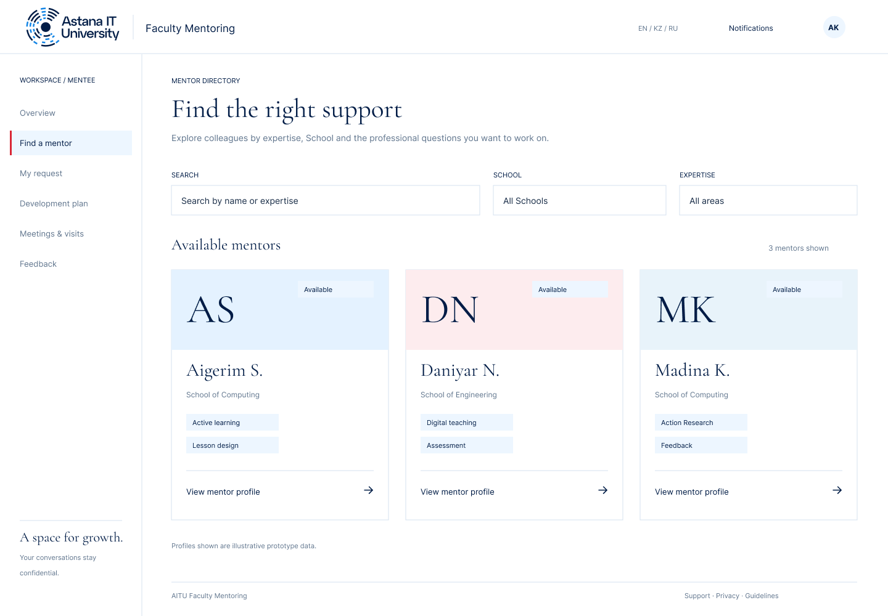
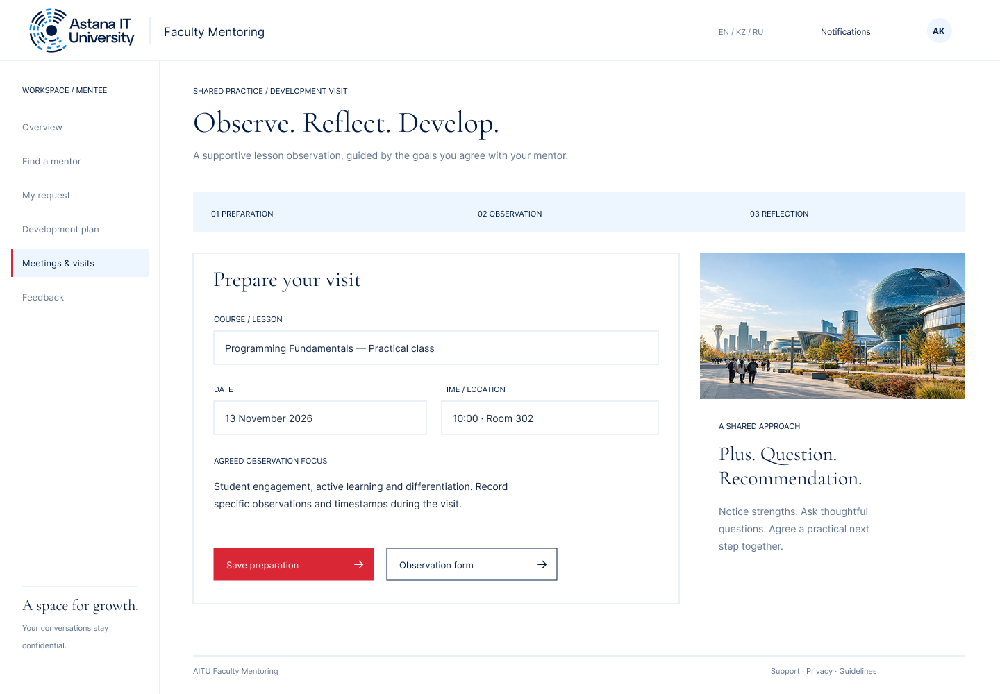
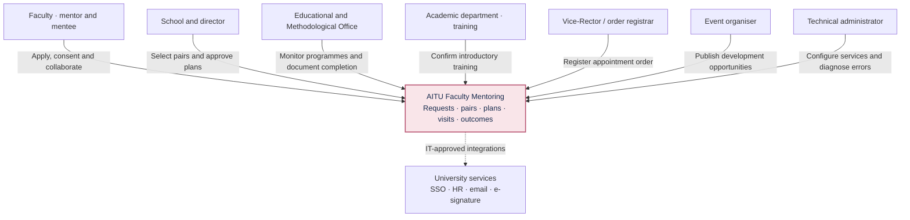
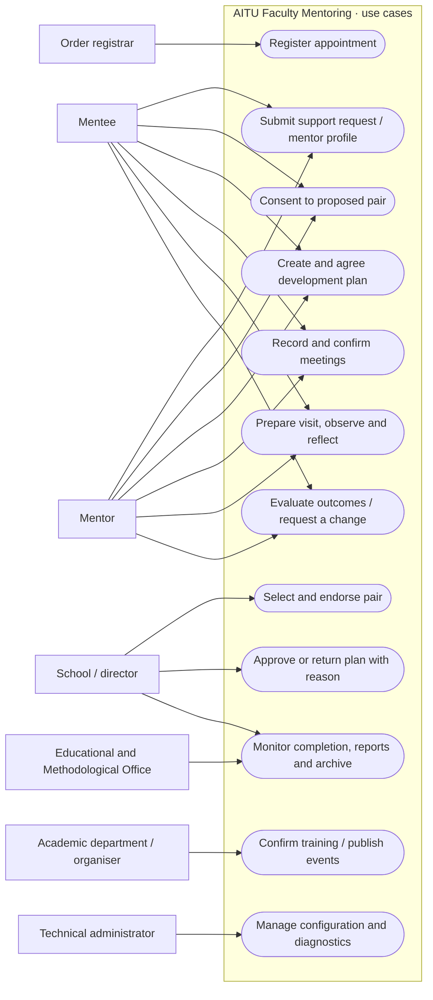
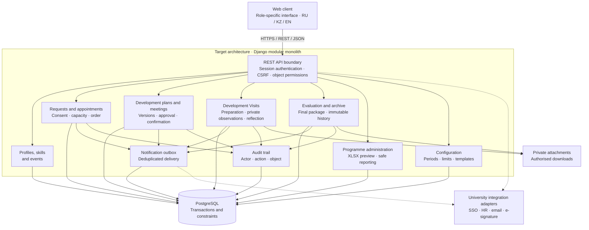

# AITU Faculty Mentoring Platform

**[Open Live Demo →](https://aitu-faculty-mentoring.vercel.app)**

**Diploma Project:** "Development of a Web Platform for Managing the Faculty Mentorship System in a Higher Education Institution"

**Student:** Karina Tulegenova
**Group**: SE-2419

**Supervisor:** Yersultan Tulebayev, Senior-lecturer

## Table of Contents

- [Introduction](#introduction)
- [Features](#features)
- [Open Data and Machine Learning](#open-data-and-machine-learning)
- [Current Scope and Future Development](#current-scope-and-future-development)
- [Getting Started and Testing](#getting-started-and-testing)
- [Repository Structure](#repository-structure)
- [Documentation](#documentation)
- [Version Control Workflow](#version-control-workflow)
- [Application Prototype](#application-prototype)
- [Client Input and Supervisor Feedback](#client-input-and-supervisor-feedback)
- [Architecture and Diagrams](#architecture-and-diagrams)
- [Conclusion](#conclusion)
- [References](#references)

## Introduction

This diploma project aims to develop a web platform for faculty mentoring at Astana IT University. The platform will connect professional development requests, mentor selection, pair approval, individual development plans, meetings, and outcome evaluation in one workflow.

The intended users are faculty mentors and mentees, School representatives and directors, and programme administrators. The project supports professional development and aims to make mentoring activities easier to organise and follow while protecting confidential conversations and observations.

An interactive interface prototype and one trained machine learning model are available for demonstration. The prototype illustrates how the future application is intended to work; it is not yet a complete multi-user system.

## Features

The browser prototype demonstrates:

- Mentor profile and mentee request forms, with locally saved drafts.
- A mentor catalogue with search and filters, and skill-based recommendations.
- A catalogue of events for exploring professional development opportunities.
- Individual development plans with activities, versions, and review decisions.
- Meetings, Development Visits, and reflection forms.
- School review and programme administration screens with summary exports.
- English, Russian, and Kazakh interface switching.

The [extended workflow demonstration](https://aitu-faculty-mentoring.vercel.app/workflow.html) also models mutual consent, appointment records, plan approval and return, meeting confirmation, and programme completion. Roles are switched manually for demonstration.

## Open Data and Machine Learning

Confidential university data was not provided for model training or demonstration. The experiment therefore uses the publicly available [UniSkill dataset](https://huggingface.co/datasets/nurlanm/UniSkill_dataset), which contains annotated relationships between university courses and professional skills. Mentor profiles and their course assignments in the interface are illustrative.

One **logistic regression model** was trained to demonstrate the recommendation approach. It estimates course–skill relevance. The prototype uses these scores and illustrative course-to-mentor assignments to rank suggested mentors for a selected skill. This demonstrates the proposed matching flow; it does not establish matching accuracy for real AITU mentoring pairs.

The model runs in the browser. Its test results are **72.69% accuracy** and **0.6938 Macro-F1** on 216 course–skill pairs. The training materials, data provenance, and evaluation are documented in the [frontend and machine learning report](docs/frontend-matching-report.md).

## Current Scope and Future Development

The current implementation uses HTML, CSS, and JavaScript. Forms and demonstration state are stored in the visitor's browser using localStorage; they are not shared between users. The sign-in screen is an interface prototype: **user registration, authentication, and server-side authorisation have not been implemented**.

Future development includes registration, authentication, role-based access controls, a shared database, backend APIs, notifications, and evaluation with intended users. The planned backend architecture is a Django modular monolith with PostgreSQL and REST/JSON. Real mentoring recommendations will require suitable authorised data and separate evaluation.

Requirements, research, interface designs, architecture diagrams, and automated tests accompany the prototype. The current interface provides a demonstration of the planned application and a foundation for its further development.

## Getting Started and Testing

Node.js 22 or later is required. From the repository root, run:

```sh
npm start
```

Open [the local prototype](http://localhost:4173). Alternatively, run `node scripts/serve.mjs`. No package installation is required. To change the port, use `PORT=4174 npm start`; a configuration example is available in `config/.env.example`. The `.env` file is not loaded automatically.

Run the tests:

```sh
npm test
```

Alternatively, run `node --test tests/*.test.mjs`. For development, run `npm install` once, then `npm run check` for formatting, documentation links, and tests or `npm run format` to format the code. Stop the server with Ctrl+C. For a complete demonstration walkthrough, see [Using the Prototype](docs/prototype.md).

## Repository Structure

The code uses separate domain, application, infrastructure, and presentation layers. See [Code Architecture](docs/code-architecture.md) for dependency rules, patterns, and extension guidance.

```text
src/prototype/main.js         Application composition root
src/prototype/domain/         Business rules and matching calculations
src/prototype/application/    Use cases and state transactions
src/prototype/infrastructure/ Storage, model loading, and downloads
src/prototype/presentation/   Pages, components, routing, and controllers
src/prototype/locales/        Russian and Kazakh translations
src/prototype/styles/         Styles grouped by purpose
scripts/                      Local HTTP server
tests/                        Domain, application, matching, and architecture tests
research/matching/            Training export, open data, and experimental results
docs/                         Requirements and project documentation
diagrams/                     Diagram sources and SVG exports
```

## Documentation

| Topic                                   | Resource                                                                             |
| --------------------------------------- | ------------------------------------------------------------------------------------ |
| Proposal and scope                      | [Project Proposal](docs/proposal.md)                                                  |
| Requirements sources and open questions | [Source Register](docs/source-register.md)                                            |
| Requirements and acceptance criteria    | [Specification](docs/requirements.md)                                                 |
| Literature                              | [Critical Review](docs/research/literature-review.md)                                 |
| Existing systems                        | [System Comparison](docs/research/system-comparison.md)                               |
| Technology                              | [Technology Comparison](docs/research/technology-comparison.md)                       |
| User research                           | [Discussion Plan](docs/research/user-research.md)                                     |
| Code structure and design patterns      | [Code Architecture](docs/code-architecture.md)                                        |
| Architecture                            | [Components, Data, and API](docs/architecture/architecture.md)                        |
| Diagrams                                | [SVG Exports](diagrams/exports/) and [Editable Sources](diagrams/source/)              |
| User experience                         | [Interactive Prototype](src/prototype/index.html) and [Walkthrough](docs/prototype.md) |
| Verification and evaluation             | [Plan](docs/verification.md) and [Verification Results](docs/project/validation.md)    |
| Tasks, risks, and review                | [Project Plan](docs/project/plan.md)                                                  |
| Project readiness                       | [Readiness Checklist](docs/project/readiness.md)                                      |

[Public YouTrack task viewer](https://karinatulegenova.youtrack.cloud/issues/DIP) · [Management and deadlines](docs/project/youtrack.md) · [Requirements traceability](docs/tz-traceability.md) · [Presentation](docs/presentation/Presentation_TulegenovaKM.pdf). Client meeting evidence and supervisor feedback are available below.

## Version Control Workflow

I develop the project through my GitHub account (`krna-tul`) and track work in YouTrack. Feature branches and pull requests record changes and validation; supervisor review is recorded separately from automated checks.

## Application Prototype

Open the **[live demonstration](https://aitu-faculty-mentoring.vercel.app)** or browse the interface designs in the [Figma folder](Figma/). PNG previews are included below. The sign-in screen and role-specific workspaces demonstrate the planned experience; they do not provide account authentication.

| Home                                                      | Mentor Catalogue                                                 |
| --------------------------------------------------------- | ---------------------------------------------------------------- |
| [](Figma/01-landing.png)      | [](Figma/04-mentors.png) |
| Discover the programme, skills, and support opportunities | Find a mentor and explore their professional profile             |

| Individual Development Plan                                           | Development Visit                                             |
| --------------------------------------------------------------------- | ------------------------------------------------------------- |
| [](Figma/06-plan.png) | [](Figma/07-visit.png) |
| Development goals, activities, deadlines, and progress                | Visit preparation, observations, and feedback                 |

<details>
<summary><strong>Educational and Methodological Office Dashboard</strong></summary>


Programme activity and document completion overview, with confidentiality requirements for private mentoring records.

</details>

[Browse Prototype Screens](Figma/) · [Local Prototype Walkthrough](docs/prototype.md)

## Client Input and Supervisor Feedback

| Source              | Contribution                                                                                                                   | Details                                                                    |
| ------------------- | ------------------------------------------------------------------------------------------------------------------------------ | -------------------------------------------------------------------------- |
| Client meeting      | Four groups of needs linked to the client's requirements                                                                       | [Evidence of Relevance](docs/research/user-research.md)                     |
| Supervisor feedback | Full publication titles, a consolidated literature review, project management and risks, and a feedback and improvements slide | [Supervisor Feedback and Improvements](docs/project/supervisor-feedback.md) |

## Architecture and Diagrams

The following diagrams expand the system context, use cases, and component views in presentation slides 16–18. They describe the target platform. The runnable browser prototype demonstrates its workflows using localStorage.

### System Context

Participants and external services are separated from the mentoring platform.


<details>
<summary>View editable Mermaid diagram</summary>



</details>

### Use Cases

Role-to-scenario overview in Mermaid; the UML source and SVG are also available in the diagram directory. Detailed Development Visit records are shared within the mentoring pair; management reports use an administrative summary.



<details>
<summary>View editable Mermaid diagram</summary>



</details>

### Component Architecture

In the planned backend, application requests will pass through authentication and object permissions. Domain modules will share a transactional database, with separate boundaries for attachments and integrations. These server-side components are not implemented in the current browser prototype.



<details>
<summary>View editable Mermaid diagram</summary>



</details>

[Architectural Decisions and API](docs/architecture/architecture.md) · [All Editable Diagram Sources](diagrams/source/) · [SVG Exports](diagrams/exports/)

## Conclusion

The AITU Faculty Mentoring Platform provides a foundation for bringing faculty development requests, mentor selection, individual plans, and progress review into a connected workflow. The interactive prototype demonstrates the proposed user experience and core mentoring scenarios in English, Russian, and Kazakh.

One logistic regression model trained on publicly available UniSkill data demonstrates how course–skill relevance can support mentor recommendations through illustrative course assignments. This experiment shows the feasibility of the recommendation flow; its results do not establish effectiveness for real university mentoring pairs.

Further development will focus on registration, authentication, server-side permissions, a shared database, and evaluation with intended users. The current prototype and model provide a basis for testing these design decisions before implementing the complete multi-user platform.

## References

1. W. Nuis, M. Segers, and S. Beausaert, “Conceptualizing mentoring in higher education: A systematic literature review,” Educ. Res. Rev., vol. 41, Art. no. 100565, 2023, [doi:10.1016/j.edurev.2023.100565](https://doi.org/10.1016/j.edurev.2023.100565).

2. M. Abdollahi and F. Heshmati Nabavi, “Mentoring as an appropriate strategy for medical faculty member development in higher education: A systematic review,” J. Adv. Med. Educ. Prof., vol. 11, no. 1, pp. 3–14, 2023, [doi:10.30476/JAMP.2022.97103.1740](https://doi.org/10.30476/JAMP.2022.97103.1740).

3. M. López-Aguado and O. Scialdone, “La mentoría como estrategia para la mejora docente en la universidad, una revisión sistemática,” Rev. Complut. Educ., vol. 37, no. 1, pp. 21–33, 2026, [doi:10.5209/rced.96870](https://doi.org/10.5209/rced.96870).

4. K. Bell, “Affordances, constraints and collaborative potential of e-mentoring platforms and their features for K–12 educators: A systematic literature review,” Int. J. Mentor. Coach. Educ., vol. 13, no. 3, pp. 346–360, 2024, [doi:10.1108/IJMCE-07-2023-0056](https://doi.org/10.1108/IJMCE-07-2023-0056).

5. F. Jin, Z. Song, W. M. Cheung, C.-H. Lin, and T. Liu, “Technological affordances in teachers’ online professional learning communities: A systematic review,” J. Comput. Assist. Learn., vol. 40, no. 3, pp. 1019–1039, 2024, [doi:10.1111/jcal.12935](https://doi.org/10.1111/jcal.12935).

6. L. Huang, M. Liang, Y. Xiong, X. Wu, and C. P. Lim, “A systematic review of technology-enabled teacher professional development during COVID-19 pandemic,” Comput. Educ., vol. 223, Art. no. 105168, 2024, [doi:10.1016/j.compedu.2024.105168](https://doi.org/10.1016/j.compedu.2024.105168).

7. L. Cutroni and A. Paladino, “Peer-ing in: A systematic review and framework of peer review of teaching in higher education,” Teach. Teach. Educ., vol. 133, Art. no. 104302, 2023, [doi:10.1016/j.tate.2023.104302](https://doi.org/10.1016/j.tate.2023.104302).

8. F. M. Otero-Saborido, J. A. Domínguez-Montes, J. M. Cenizo-Benjumea, and G. González-Calvo, “Peer observation of teaching in higher education: Systematic review of observation tools,” Educ. Process: Int. J., vol. 13, no. 1, pp. 84–101, 2024, [doi:10.22521/edupij.2024.131.6](https://doi.org/10.22521/edupij.2024.131.6).

9. B. De la Iglesia, D. Forteza, and L. Duma, “Peer feedback in teacher professional development: A systematic review,” Rev. Esp. Pedagog., vol. 82, no. 288, pp. 335–358, 2024, [doi:10.22550/2174-0909.4044](https://doi.org/10.22550/2174-0909.4044).

10. E. Cano García, “Peer feedback for teaching professional development: Conditions for it to take effect,” Cogent Educ., vol. 11, no. 1, Art. no. 2391577, 2024, [doi:10.1080/2331186X.2024.2391577](https://doi.org/10.1080/2331186X.2024.2391577).

11. P. Hunt, Ä. Leijen, and M. van der Schaaf, “Automated feedback is nice and human presence makes it better: Teachers’ perceptions of feedback by means of an e-portfolio enhanced with learning analytics,” Educ. Sci., vol. 11, no. 6, Art. no. 278, 2021, [doi:10.3390/educsci11060278](https://doi.org/10.3390/educsci11060278).

12. A. Wang, S. Yu, M. Wang, and L. Chen, “Effects of the visual analytics of peer feedback on teachers’ TPACK development in a lesson study,” Interact. Learn. Environ., vol. 32, no. 8, pp. 4632–4651, 2024, [doi:10.1080/10494820.2023.2204354](https://doi.org/10.1080/10494820.2023.2204354).

13. Together, “Together mentorship platform.” Accessed: Oct. 15, 2026. [Online source](https://www.togetherplatform.com/page/mentorship-software-platform).

14. Chronus, “Mentoring software.” Accessed: Oct. 15, 2026. [Online source](https://chronus.com/software/mentoring-software).

15. IRIS Connect, “Video technology.” Accessed: Oct. 15, 2026. [Online source](https://www.irisconnect.com/us/video-technology/).

16. IRIS Connect, “Instructional coaching.” Accessed: Oct. 15, 2026. [Online source](https://www.irisconnect.com/uk/instructional-coaching/).

17. IRIS Connect, “Progress tracking (Objectives).” Accessed: Oct. 15, 2026. [Online source](https://www.irisconnect.com/uk/progress-tracking/).

18. IRIS Connect, “Adaptive professional development.” Accessed: Oct. 15, 2026. [Online source](https://www.irisconnect.com/uk/adaptive-pd/).

19. Chronus, “Mentor matching.” Accessed: Oct. 15, 2026. [Online source](https://chronus.com/software/mentoring-software/mentor-matching).

20. Chronus, “Privacy Notice.” Accessed: Oct. 15, 2026. [Online source](https://mentoring365.chronus.com/p/p1/privacy_policy).

21. N. Musazade, “UniSkill_dataset,” Hugging Face, 2026. [Data set](https://huggingface.co/datasets/nurlanm/UniSkill_dataset).

22. N. Musazade, J. Mezei, and M. Zhang, “UniSkill: A dataset for matching university curricula to professional competencies,” in *Proceedings of the Fifteenth Language Resources and Evaluation Conference*, ELRA Language Resource Association, 2026, pp. 456–469. [doi:10.63317/2n39qzvk2eqe](https://doi.org/10.63317/2n39qzvk2eqe).
