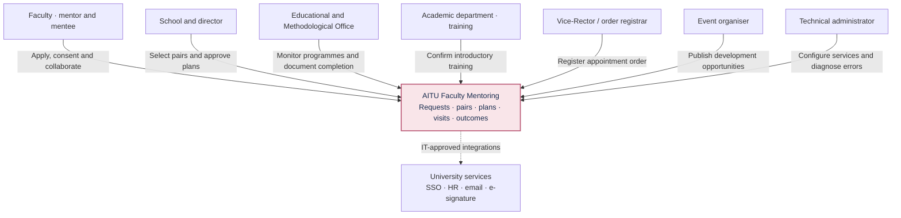
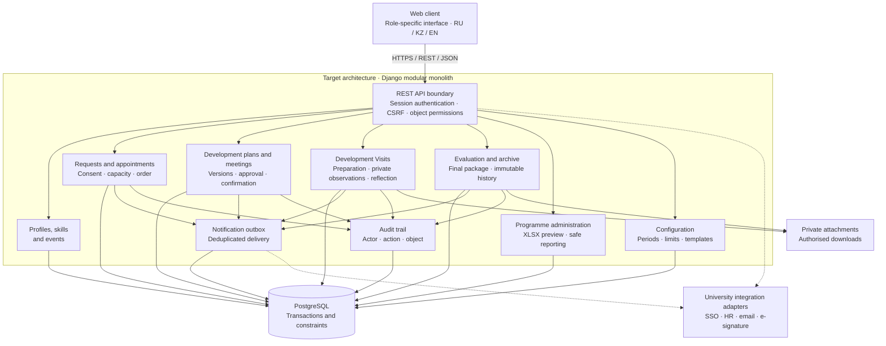

# AITU Faculty Mentoring Platform

A diploma project developing a web platform for managing faculty mentoring in higher education. The platform connects professional development requests, mentor selection, pair approval, individual development plans, meetings, and outcome evaluation.

Karina Maratovna Tulegenova · Software Engineering · SE-2419

Supervisor: Yersultan Bakhytovich Tulebayev.

I am responsible for requirements analysis, architecture, frontend and backend development, and system verification.

## Table of Contents

- [Problem and Users](#problem-and-users)
- [Features](#features)
- [Current Status and Scope](#current-status-and-scope)
- [Update: 22 October 2026](#update-22-october-2026)
- [Getting Started and Testing](#getting-started-and-testing)
- [Repository Structure](#repository-structure)
- [Documentation](#documentation)
- [Version Control Workflow](#version-control-workflow)
- [Application Prototype](#application-prototype)
- [Client Input and Supervisor Feedback](#client-input-and-supervisor-feedback)
- [Architecture and Diagrams](#architecture-and-diagrams)

## Problem and Users

AITU's mentoring regulations involve several related documents and organisational stages. This project brings them into a single workflow and makes progress visible to participants. The client meeting on 8 October 2026 addressed roles, confidentiality, support requests, development plans, and reporting. See the [meeting findings](docs/research/user-research.md).

The intended users are faculty mentors and mentees, School representatives and directors, the academic department, order registrars, and event organisers. Mentoring supports professional development; detailed observations and reflections within each mentoring pair remain confidential.

## Features

- Separate application forms for mentor candidates and mentee support requests.
- A searchable skills catalogue and events listing for exploring development opportunities.
- School review of mentor candidates and confirmation of introductory training.
- Mentor selection, consent from both participants, director endorsement, and registration of the Vice-Rector's appointment order.
- Shared individual development plans with versions, activities, deadlines, support, and expected outcomes.
- Meetings, Development Visits, and interim and final evaluations.
- Replacement requests and programme-level summaries.

## Current Status and Scope

Requirements, a literature review, system and technology comparisons, architecture, diagrams, an evaluation plan, and an interactive prototype are available. The prototype runs locally in a single browser using localStorage. Profiles and programmes are illustrative; the recommendation model uses publicly available annotated course–skill pairs from UniSkill. Confidential university data was not provided for training or demonstration. Server-side authentication and authorisation, a shared database, integrations, and notifications are planned for the next stage. The frontend supports English, Russian, and Kazakh through the EN / KZ / RU switcher; the language preference is stored in the browser. User-entered content and original UniSkill course and skill texts remain unchanged.

The target architecture is a Django modular monolith with PostgreSQL and REST/JSON. The frontend framework will be selected after UX validation. The current prototype uses HTML, CSS, and JavaScript; Node.js provides the local HTTP server and tests. No npm dependencies are required to run the frontend. Typography is loaded from Google Fonts with system-font fallbacks; retraining the model requires Python dependencies.

The intended diploma outcome is a multi-user platform with verifiable access controls and a usability evaluation against the existing manual document workflow. A complete application is not required for the first milestone on 24 October.

## Update: 22 October 2026

The frontend implements the eleven supplied interface designs. Working JavaScript logistic regression inference from `aitu-mentoring` is integrated into the following flow: **My request → Find recommendations by skill → Find recommended mentors → View course evidence**. Course links can be edited through **Manage demo course assignments**.

To switch roles, use the avatar or **Demo workspaces** at the bottom of the page. The new screens demonstrate a simplified local workflow. The original complete appointment and mutual-consent workflow remains available at [workflow.html](http://localhost:4173/workflow.html) and uses separate browser state.

See the [frontend, open data, and logistic regression report](docs/frontend-matching-report.md). Results on 216 UniSkill pairs are 72.69% accuracy and 0.6938 Macro-F1. These metrics measure course–skill relevance, not validated mentor-matching accuracy at AITU. The refactored code passes 30 automated tests, including comparison of thirty Python/JavaScript examples and checks of application behaviour and layer boundaries.

## Getting Started and Testing

Node.js 22 or later is required. From the repository root, run:

```sh
npm start
```

Open [the local prototype](http://localhost:4173). Alternatively, run `node scripts/serve.mjs`. No package installation is required. To change the port, use `PORT=4174 npm start`; a configuration example is available in `config/.env.example`. The `.env` file is not loaded automatically.

Run the tests:

```sh
npm test
```

Alternatively, run `node --test tests/*.test.mjs`. For development, run `npm install` once, then `npm run check` for formatting, documentation links, and tests or `npm run format` to format the code. Stop the server with Ctrl+C. For a complete demonstration walkthrough, see [Using the Prototype](docs/prototype.md).

## Repository Structure

The code uses separate domain, application, infrastructure, and presentation layers. See [Code Architecture](docs/code-architecture.md) for dependency rules, patterns, and extension guidance.

```text
src/prototype/main.js         Application composition root
src/prototype/domain/         Business rules and matching calculations
src/prototype/application/    Use cases and state transactions
src/prototype/infrastructure/ Storage, model loading, and downloads
src/prototype/presentation/   Pages, components, routing, and controllers
src/prototype/locales/        Russian and Kazakh translations
src/prototype/styles/         Styles grouped by purpose
scripts/                      Local HTTP server
tests/                        Domain, application, matching, and architecture tests
research/matching/            Training export, open data, and experimental results
docs/                         Requirements and project documentation
diagrams/                     Diagram sources and SVG exports
```

## Documentation

| Topic | Resource |
| --- | --- |
| Proposal and scope | [Project Proposal](docs/proposal.md) |
| Requirements sources and open questions | [Source Register](docs/source-register.md) |
| Requirements and acceptance criteria | [Specification](docs/requirements.md) |
| Literature | [Critical Review](docs/research/literature-review.md) |
| Existing systems | [System Comparison](docs/research/system-comparison.md) |
| Technology | [Technology Comparison](docs/research/technology-comparison.md) |
| User research | [Discussion Plan](docs/research/user-research.md) |
| Code structure and design patterns | [Code Architecture](docs/code-architecture.md) |
| Architecture | [Components, Data, and API](docs/architecture/architecture.md) |
| Diagrams | [SVG Exports](diagrams/exports/) and [Editable Sources](diagrams/source/) |
| User experience | [Interactive Prototype](src/prototype/index.html) and [Walkthrough](docs/prototype.md) |
| Verification and evaluation | [Plan](docs/verification.md) and [Verification Results](docs/project/validation.md) |
| Tasks, risks, and review | [Project Plan](docs/project/plan.md) |
| First pre-defence | [Readiness for 24 October](docs/project/readiness.md) |

[Public YouTrack task viewer](https://karinatulegenova.youtrack.cloud/issues/DIP) · [Management and deadlines](docs/project/youtrack.md) · [Requirements traceability](docs/tz-traceability.md) · [Presentation](docs/presentation/Presentation_TulegenovaKM.pdf). Client meeting evidence and supervisor feedback are available below.

## Version Control Workflow

I develop the project through my GitHub account (`krna-tul`) and track work in YouTrack. Feature branches and pull requests record changes and validation; supervisor review is recorded separately from automated checks.

## Application Prototype

Browse the application screens in the [Figma folder](Figma/). PNG previews are included below.

| Home | Mentor Catalogue |
| --- | --- |
| [](Figma/01-landing.png) | [](Figma/04-mentors.png) |
| Discover the programme, skills, and support opportunities | Find a mentor and explore their professional profile |

| Individual Development Plan | Development Visit |
| --- | --- |
| [](Figma/06-plan.png) | [](Figma/07-visit.png) |
| Development goals, activities, deadlines, and progress | Visit preparation, observations, and feedback |

<details>
<summary><strong>Educational and Methodological Office Dashboard</strong></summary>


Programme activity and document completion overview, with confidentiality requirements for private mentoring records.

</details>

[Browse Prototype Screens](Figma/) · [Local Prototype Walkthrough](docs/prototype.md)

## Client Input and Supervisor Feedback

| Source | Contribution | Details |
| --- | --- | --- |
| Client meeting · 8 October 2026 | Four groups of needs linked to the client's requirements | [Evidence of Relevance](docs/research/user-research.md) |
| Supervisor feedback | Full publication titles, a consolidated literature review, project management and risks, and a feedback and improvements slide | [Supervisor Feedback and Improvements](docs/project/supervisor-feedback.md) |


## Architecture and Diagrams

The following diagrams expand the system context, use cases, and component views in presentation slides 16–18. They describe the target platform. The runnable browser prototype demonstrates its workflows using localStorage.

### System Context

Participants and external services are separated from the mentoring platform.


<details>
<summary>View editable Mermaid diagram</summary>



</details>

### Use Cases

Role-to-scenario overview in Mermaid; the UML source and SVG are also available in the diagram directory. Detailed Development Visit records are shared within the mentoring pair; management reports use an administrative summary.


<details>
<summary>View editable Mermaid diagram</summary>


</details>

### Component Architecture

Every application request passes through authentication and object permissions. Domain modules share a transactional database; attachments and integrations have explicit boundaries.


<details>
<summary>View editable Mermaid diagram</summary>



</details>

[Architectural Decisions and API](docs/architecture/architecture.md) · [All Editable Diagram Sources](diagrams/source/) · [SVG Exports](diagrams/exports/)
