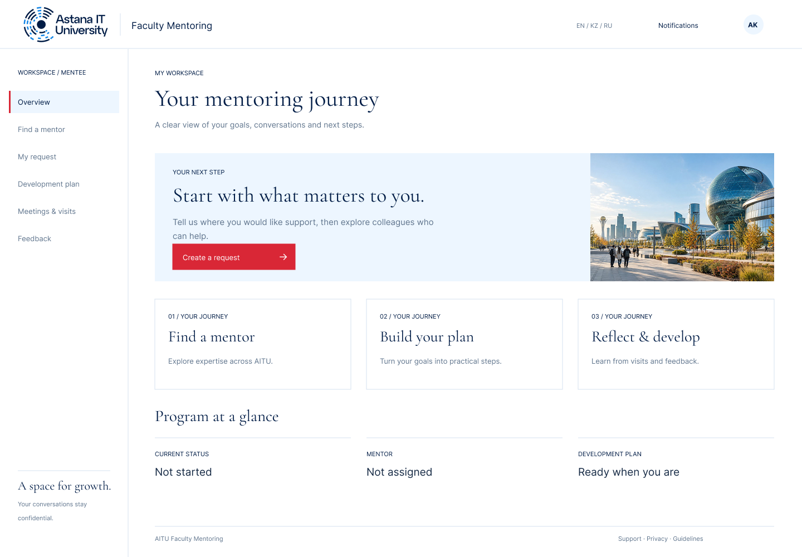
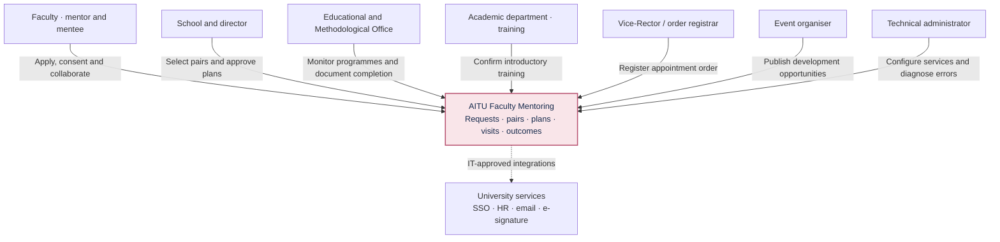
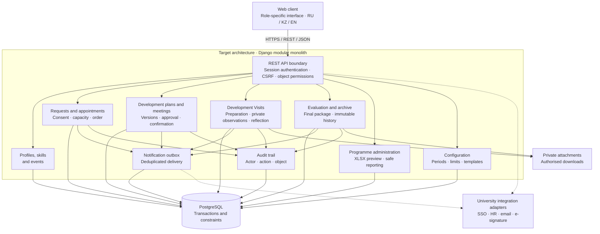

<div align="center">

# AITU Faculty Mentoring

**A platform for faculty professional development**

[Prototype Screens](Figma/) · [Public Task Viewer](https://karinatulegenova.youtrack.cloud/issues/DIP) · [Presentation (PDF)](docs/presentation/Presentation_TulegenovaKM.pdf) · [Documentation](#documentation) · [Getting Started](#getting-started)

</div>



A diploma project developing a web platform for managing faculty mentoring in higher education. The platform connects professional support requests, mentor selection, pair approval, individual development plans, meetings, and outcome evaluation.

**Project format:** Individual diploma project; Karina Tulegenova is the sole developer.

**Author:** Karina Maratovna Tulegenova · Software Engineering · SE-2419  
**Supervisor:** Yersultan Bakhytovich Tulebayev  
**Responsibilities:** requirements analysis, architecture, frontend and backend development, and system verification.

## Problem and Users

AITU's mentoring process involves several related documents and approval stages. The project brings these activities into a connected workflow so participants can follow their progress.

The client meeting on **8 October 2026** with representatives of the Educational and Methodological Office addressed roles and confidentiality, support requests and assignments, development plans and feedback, and monitoring and reporting. The client's technical specification defines the project requirements. [Meeting findings and requirements](docs/research/user-research.md).

The platform serves mentors, mentees, School representatives and directors, the academic department, order registrars, event organisers, and the Educational and Methodological Office. Detailed observations and reflections remain confidential within the mentoring pair.

## Project Scope

- Separate mentor candidate applications and mentee support requests.
- A searchable skills catalogue and professional development events.
- School review of candidates and confirmation of introductory training.
- Mentor selection, consent from both participants, director endorsement, and registration of the Vice-Rector's order.
- Shared individual development plans with revisions, tasks, deadlines, support, and expected outcomes.
- Meetings, Development Visits, and interim and final evaluations.
- Replacement requests and programme-level summaries.

The expected outcome is a multi-user platform with role-based access and an evaluation of usability against the existing document-based process.

## Current Development Status

As of 20 October 2026, research, requirements, target architecture, diagrams, screen designs, and a runnable local browser prototype are available. Automated verification passes 17 domain tests and local documentation link checks.

Current work: complete the GitHub/YouTrack management checklist by **22 October 2026**, including structured deadlines, task dependencies, and traceable evidence. Independent review of PR #3 remains pending. The repository is public at the supervisors’ request; reading access is available without an invitation, and existing collaborator access for `YersultanTulebayev` has been verified.

Planned: Django backend, PostgreSQL, server-side authentication and permissions, integrations, and user evaluation. The current prototype stores synthetic data in localStorage.

The management deadline is **22 October**; the first pre-defence is **24 October**. Presentation preparation on 23 October is a separate activity.

## Development Workflow

Karina Tulegenova performs analysis, design, implementation, testing, and documentation through her own GitHub account (`krna-tul`) and YouTrack account (`admin`). The supervisor reviews scope, architecture, and results.

For each development task, create a branch such as `feature/DIP-13-backend`, include its YouTrack ID in commits, and open a Pull Request linked to the issue. Record validation and obtain an appropriate review before merging. A self-check or automated check does not count as independent supervisor approval. Link the final commit or PR back from YouTrack and mark the task Done only when its acceptance criteria are met.

## Application Prototype

Browse the application screens in the [Figma folder](Figma/). PNG previews are included below.

| Home | Mentor Catalogue |
| --- | --- |
| [](Figma/01-landing.png) | [](Figma/04-mentors.png) |
| Discover the programme, skills, and support opportunities | Find a mentor and explore their professional profile |

| Individual Development Plan | Development Visit |
| --- | --- |
| [](Figma/06-plan.png) | [](Figma/07-visit.png) |
| Development goals, activities, deadlines, and progress | Visit preparation, observations, and feedback |

<details>
<summary><strong>Educational and Methodological Office Dashboard</strong></summary>


Programme activity and document completion overview, with confidentiality requirements for private mentoring records.

</details>

[Browse Prototype Screens](Figma/) · [Local Prototype Walkthrough](docs/prototype.md)

## Client Input and Supervisor Feedback

| Source | Contribution | Details |
| --- | --- | --- |
| Client meeting · 8 October 2026 | Four groups of needs linked to the client's requirements | [Evidence of Relevance](docs/research/user-research.md) |
| Supervisor feedback | Full publication titles, a consolidated literature review, project management and risks, and a feedback and improvements slide | [Supervisor Feedback and Improvements](docs/project/supervisor-feedback.md) |


## Architecture and Diagrams

The following diagrams expand the system context, use cases, and component views in presentation slides 16–18. They describe the target platform. The runnable browser prototype demonstrates its workflows using localStorage.

### System Context

Participants and external services are separated from the mentoring platform.


<details>
<summary>View editable Mermaid diagram</summary>



</details>

### Use Cases

Role-to-scenario overview in Mermaid; the UML source and SVG are also available in the diagram directory. Detailed Development Visit records are shared within the mentoring pair; management reports use an administrative summary.


<details>
<summary>View editable Mermaid diagram</summary>


</details>

### Component Architecture

Every application request passes through authentication and object permissions. Domain modules share a transactional database; attachments and integrations have explicit boundaries.


<details>
<summary>View editable Mermaid diagram</summary>



</details>

[Architectural Decisions and API](docs/architecture/architecture.md) · [All Editable Diagram Sources](diagrams/source/) · [SVG Exports](diagrams/exports/)

## Technology

The target architecture is a **Django modular monolith**, **PostgreSQL**, and **REST/JSON**, supporting the mentoring workflow and role-based access.

The local interactive prototype uses **HTML, CSS, and JavaScript**, with browser localStorage for demonstration data. **Node.js** provides the local HTTP server and automated domain tests. See the [technology comparison](docs/research/technology-comparison.md) for the alternatives and selection rationale.

## Getting Started

Use **Node.js 22 or later**. From the repository root, start the local prototype:

```sh
npm start
```

Open http://localhost:4173. You can also run `node scripts/serve.mjs` directly. To use another port:

```sh
PORT=4174 npm start
```

A configuration example is provided in `config/.env.example`. Supply environment variables through your shell. Stop the server with **Ctrl+C**.

Run the checks:

```sh
npm run check
```

This checks JavaScript syntax, local documentation links, and domain scenarios. To run the domain tests separately:

```sh
node --test tests/*.test.mjs
```

Follow the [prototype walkthrough](docs/prototype.md) for the demonstration scenarios.

## Repository Structure

```text
src/prototype/       User interface and workflow model
scripts/             Local server and documentation checks
config/              Configuration example
tests/               Automated domain tests
docs/                Requirements and project documentation
diagrams/source/     Editable Mermaid and PlantUML diagrams
diagrams/exports/    Readable SVG diagrams
```

## Documentation

| Topic | Resource |
| --- | --- |
| Presentation | [Full Presentation (PDF)](docs/presentation/Presentation_TulegenovaKM.pdf) |
| Project proposal and scope | [Project Proposal](docs/proposal.md) |
| Client specification coverage | [Requirements Traceability](docs/tz-traceability.md) |
| Source materials | [Source Register](docs/source-register.md) |
| Requirements and acceptance criteria | [Requirements Specification](docs/requirements.md) |
| Literature | [Critical Literature Review](docs/research/literature-review.md) |
| Existing systems | [System Comparison](docs/research/system-comparison.md) |
| Technology decisions | [Technology Comparison](docs/research/technology-comparison.md) |
| User research | [Client Meeting Findings](docs/research/user-research.md) |
| Architecture | [Components, Data, and API](docs/architecture/architecture.md) |
| Diagrams | [SVG Exports](diagrams/exports/) and [Editable Sources](diagrams/source/) |
| User experience | [Interactive Prototype](src/prototype/index.html) and [Walkthrough](docs/prototype.md) |
| Verification and evaluation | [Evaluation Plan](docs/verification.md) and [Verification Results](docs/project/validation.md) |
| Project management and risks | [Project Plan](docs/project/plan.md) and [YouTrack Tasks](docs/project/youtrack.md) |
| Supervisor feedback | [Feedback and Improvements](docs/project/supervisor-feedback.md) |
| First pre-defence | [24 October Checklist](docs/project/readiness.md) |

[View Project Tasks — Public, Read Only](https://karinatulegenova.youtrack.cloud/issues/DIP)

The public YouTrack task viewer opens without signing in. Visitors can read tasks and comments; creating, editing, and deleting are disabled.
