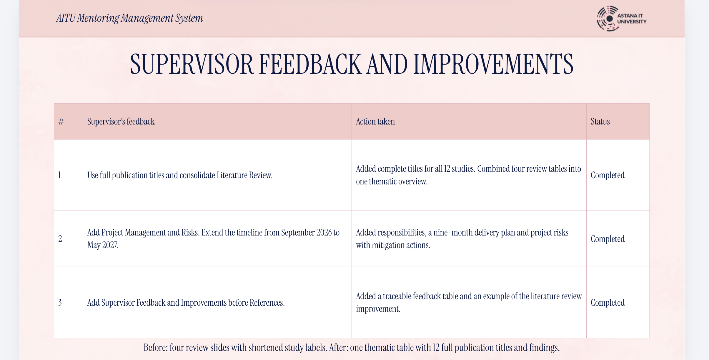

# Замечания руководителя и изменения

Автор подтвердила, что приложенный слайд **Supervisor Feedback and Improvements** представляет отзыв супервайзера по презентации. Три замечания и выполненные действия зафиксированы ниже. Дата самого отзыва не указана; 15 октября — дата передачи материалов. Отзыв по презентации не означает отдельного review кода или архитектуры репозитория.

| Замечание | Выполненное изменение | Подтверждение | Открытый шаг |
| --- | --- | --- | --- |
| Указать полные названия публикаций и собрать Literature Review на одном слайде | Canva слайд 4, 12 полных названий | [Презентация](https://www.canva.com/design/DAHX4M_h4Jk/jzrlIAl0YynEVf303Q_fIA/edit) | Набор из 12 научных статей перенесен в репозиторий с той же нумерацией; полный анализ и review остаются открытыми |
| Добавить Project Management and Risks; сентябрь 2026 — май 2027 | Canva слайд 28, ответственности, сроки и риски; план репозитория расширен | Презентация и plan.md | [YouTrack DIP](https://karinatulegenova.youtrack.cloud/issues/DIP) создан; план связан с реальными задачами |
| Добавить Supervisor Feedback and Improvements перед References | Canva слайд 29, три замечания, действия и статусы | Презентация, References слайд 30 | Получить подтверждение руководителя и review требований/архитектуры |

## Следующая проверка

К 21 октября показать руководителю требования, контекст/Use Case/компоненты, сравнительную таблицу технологий, прототип и план оценки. Зафиксировать фактическую дату, проверенные материалы, точный смысл замечания, принятое решение, ссылку на исправление и подтверждение повторной проверки. Не отмечать review завершенным до получения реального отзыва.
