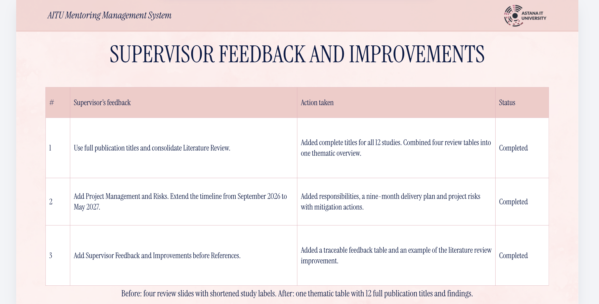

# Supervisor Feedback and Changes

The author confirmed that the attached **Supervisor Feedback and Improvements** slide records the supervisor's feedback on the presentation. The three comments and the actions taken are listed below.

| Comment | Change made | Evidence | Result |
| --- | --- | --- | --- |
| Give the full titles of publications and gather the Literature Review on one slide | Canva slide 4, 12 full titles | [Presentation](https://www.canva.com/design/DAHX4M_h4Jk/jzrlIAl0YynEVf303Q_fIA/edit) | 12 scientific articles moved into the repository with the same numbering |
| Add Project Management and Risks; September 2026 – May 2027 | Canva slide 28, responsibilities, deadlines and risks; repository plan extended | Presentation and plan.md | [YouTrack DIP](https://karinatulegenova.youtrack.cloud/issues/DIP) created; the plan is linked to real tasks |
| Add Supervisor Feedback and Improvements before References | Canva slide 29, three comments, actions and statuses | Presentation, References slide 30 | The supervisor's feedback and the completed fixes are recorded |

## Result

The supervisor's feedback has been received. All three recommendations are done and reflected in the presentation and the documentation. DIP-10 — Done.
