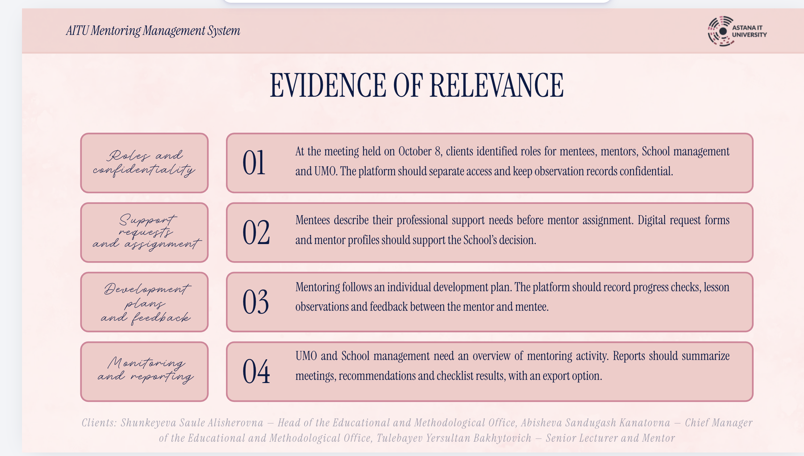

# Client Meeting and Needs Validation

## Meeting on 8 October 2026

On 8 October 2026 a meeting took place with the clients from the Educational and Methodological Department. The key points of the discussion are shown on the **Evidence of relevance** slide, and the technical specification contains the clients' requirements. Below is a summary of the meeting and its link to the project decisions.

Participants named on the slide:

- Shunkeyeva Saule Alisherovna — Head of the Educational and Methodological Office.
- Abisheva Sandugash Kanatovna — Chief Manager of the Educational and Methodological Office.
- Tulebayev Yersultan Bakhytovich — Senior Lecturer and Mentor.

| Topic | Clients' point | Project decision and check |
| --- | --- | --- |
| Roles and confidentiality | Separate access for mentees, mentors, School management and the academic office; keep observations confidential | Role model and object permissions; private records are not included in the general summary. See the requirements and architecture |
| Request and appointment | The mentee states the need before the appointment; digital forms and profiles support the School's decision | An application with the professional need and a mentor catalogue; the appointment goes through human approval |
| Plan and feedback | Mentoring follows an individual plan; progress checks, class observations and feedback within the pair are needed | Plan versions, activities, meetings and Development Visit |
| Monitoring and reporting | The academic office and the School need an overview of activity; a summary of meetings, recommendations and checklists with export | Aggregated reports and export that respect access rights; detailed observations stay private |

Related materials: [requirements](../requirements.md), [architecture](../architecture/architecture.md), [specification coverage](../tz-traceability.md). The meeting and the specification confirm the relevance of the project and the clients' requirements. The result is recorded in DIP-3.

## Further validation

## Plan for further user evaluation

For further refinement: a novice lecturer, an experienced mentor, a School director or representative, a staff member of the academic department; if available, a lecturer with a voluntary request. The author organises the discussions independently, with consent to recording and anonymisation.

Questions: how is a mentor chosen today; show the path of the last application; where are time and documents lost; who approves appointments and plans; what may management see; what gets in the way of meetings; how is a skill chosen; what confirms that mentoring is useful; which fields are required and which are redundant?

After the questions, the participant completes the scenario "find a skill → request support → understand the status → draft a plan" in the prototype. Time, errors and the need for help are measured. The first attempt is made without the researcher's help.

## Record template

| Date and participant code | Role | Consent | Observed fact / anonymised quote | Finding | Affected FR | Change and approval |
| --- | --- | --- | --- | --- | --- | --- |
| Not filled in | — | — | — | — | — | — |

Hypotheses: H1 lecturers find it hard to formulate a request; H2 the approval status is not transparent; H3 a single plan reduces repeated data entry; H4 the skills showcase helps the choice. Each hypothesis can be refuted; contradicting answers are kept.
