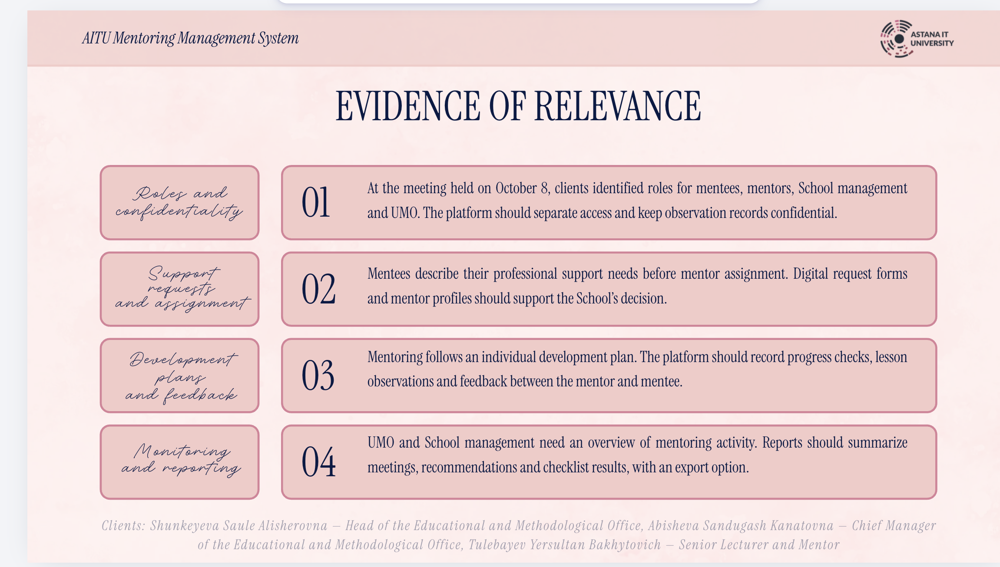

# Встреча с клиентами и проверка потребностей

## Встреча 8 октября 2026

Автор проекта подтвердила, что тезисы слайда **Evidence of relevance** отражают обсуждение с клиентами 8 октября. Источник — предоставленный слайд презентации; ниже приведено содержательное резюме, а не дословная стенограмма. Точные цитаты, длительность встречи и дополнительные результаты не добавляются.

Участники, указанные на слайде:

- Shunkeyeva Saule Alisherovna — Head of the Educational and Methodological Office.
- Abisheva Sandugash Kanatovna — Chief Manager of the Educational and Methodological Office.
- Tulebayev Yersultan Bakhytovich — Senior Lecturer and Mentor.

| Тема | Тезис клиентов | Решение проекта и проверка |
| --- | --- | --- |
| Роли и конфиденциальность | Разделить доступ наставляемых, наставников, руководства Школы и УМО; сохранять конфиденциальность наблюдений | Ролевая модель и объектные права; частные записи не включаются в общую сводку. См. требования и архитектуру |
| Запрос и назначение | Наставляемый формулирует потребность до назначения; цифровые формы и профили поддерживают решение Школы | Заявка с профессиональной потребностью и каталог наставников; назначение проходит человеческое согласование |
| План и обратная связь | Наставничество следует индивидуальному плану; нужны проверки прогресса, наблюдения занятий и обратная связь пары | Версии плана, мероприятия, встречи и Development Visit |
| Мониторинг и отчетность | УМО и Школе нужен обзор активности; сводка встреч, рекомендаций и чеклистов с экспортом | Обобщенные отчеты и экспорт с учетом прав доступа; подробные наблюдения остаются частными |

Связанные материалы: [требования](../requirements.md), [архитектура](../architecture/architecture.md), [покрытие ТЗ](../tz-traceability.md). Встреча подтверждает обсуждение потребностей с тремя представителями заказчика; она не обозначается как три отдельных интервью или проведенный usability-тест. Для критерия о 3–5 обсуждениях/соглашении с клиентом требуется оценить достаточность этого свидетельства с руководителем.

## Дальнейшая проверка

## План 3–5 обсуждений

Для дальнейшего уточнения: начинающий преподаватель, опытный наставник, директор/представитель Школы, сотрудник академического департамента; при доступности — преподаватель с добровольным запросом. Автор организует обсуждения самостоятельно, с согласием на запись и обезличивание.

Вопросы: как сейчас выбирают наставника; покажите путь последней заявки; где теряются время и документы; кто согласует назначения и планы; что можно видеть руководству; что мешает встречам; как выбирают навык; чем подтверждается полезность наставничества; какие поля обязательны и какие избыточны?

После вопросов участник выполняет в прототипе сценарий «найти навык → запросить поддержку → понять статус → составить план». Измеряются время, ошибки и необходимость помощи. Первая попытка выполняется без помощи исследователя.

## Шаблон записи

| Дата и код участника | Роль | Согласие | Наблюдаемый факт/обезличенная цитата | Вывод | Затронутое FR | Изменение и согласование |
| --- | --- | --- | --- | --- | --- | --- |
| Не заполнено | — | — | — | — | — | — |

Гипотезы: H1 преподаватели затрудняются сформулировать запрос; H2 статус согласования непрозрачен; H3 единый план снижает повторный ввод; H4 витрина навыков помогает выбору. Каждая гипотеза может быть опровергнута; сохранять противоречащие ответы.
